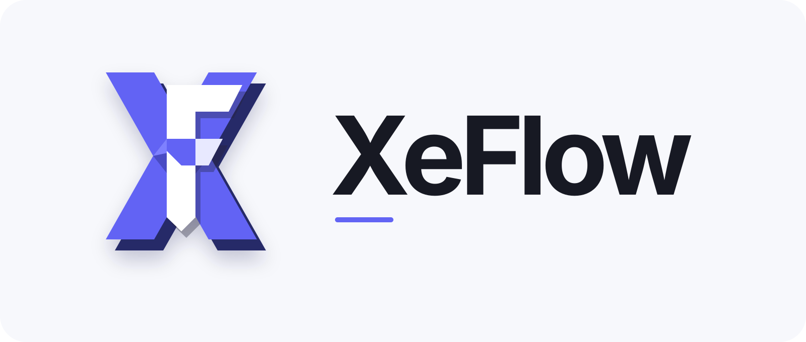
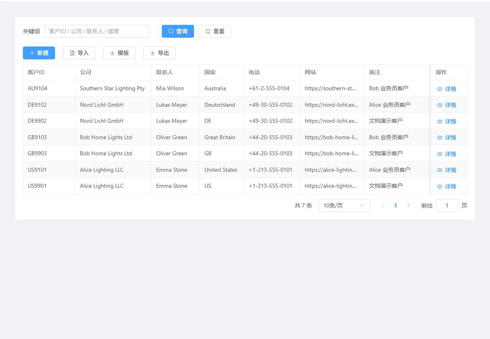
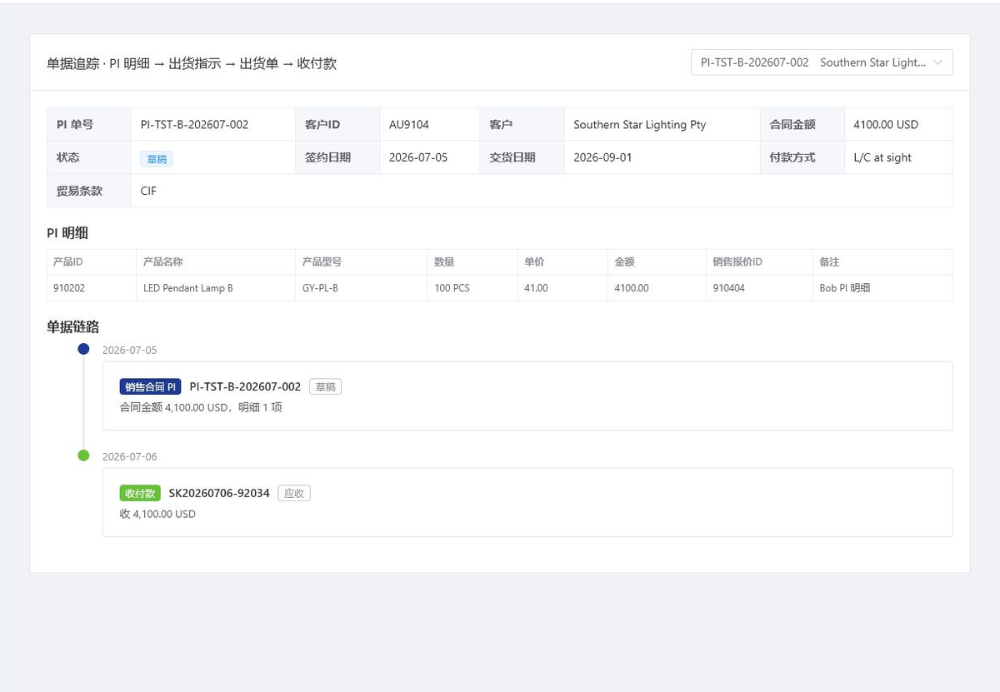
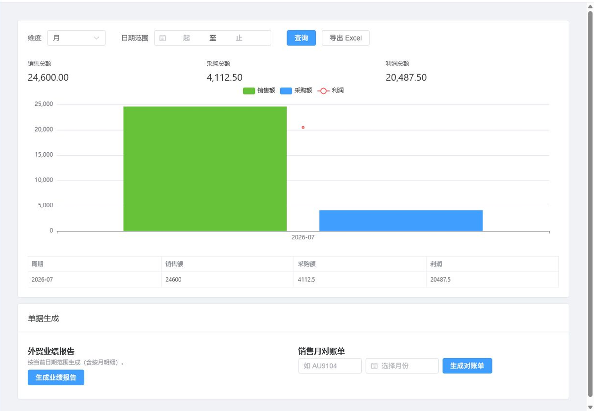
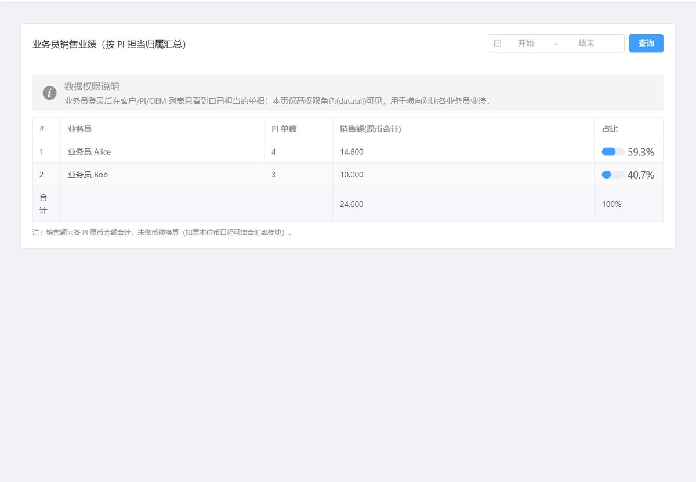
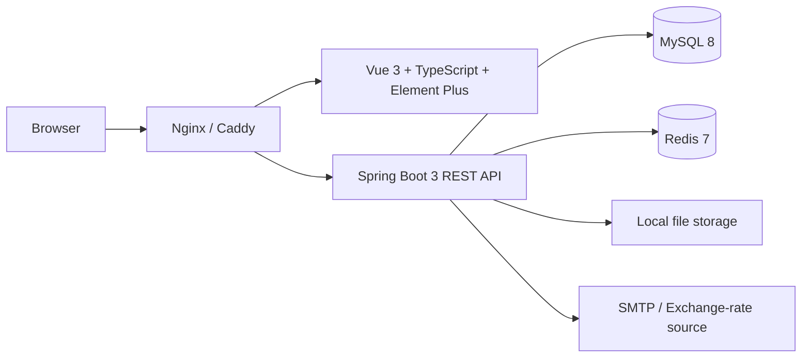

<p align="center">
  
</p>

<p align="center">
  面向小型外贸团队的开源 ERP，覆盖客户开发、报价、PI、采购、出货、库存、财务与经营分析。
</p>

<p align="center">
  <a href="LICENSE"></a>
  <a href=".github/workflows/ci.yml"></a>
  
  
</p>

## XeFlow 是什么

XeFlow 是一个前后端分离的外贸业务管理系统。它以业务员开发客户为主线，将销售报价、销售合同 PI、OEM 要求、PO 采购、出货指示、出货单、库存、应收应付和经营报表串成可追踪的业务闭环。

这个仓库是从实际业务项目整理出的**独立开源版本**：不包含原项目 Git 历史、生产数据、服务器地址、真实域名、邮箱凭据或可登录的默认密码。所有组织信息均改为可配置项。

## 核心能力

| 领域 | 能力 |
| --- | --- |
| 客户与产品 | 公共/个人客户池、担当分配、客户附件、产品与配件资料、批量导入导出 |
| 销售 | 产品报价、销售报价审核、PI 生命周期、定金/全款约束、单据追踪 |
| 采购与履约 | OEM、PO 确认与分批入库、出货指示、多产品明细、部分/全部出货 |
| 库存 | PO 入库自动登记、库存余量校验、分批出货与剩余数量 |
| 财务 | 收付款流水、应收、应付、原币结清、本位币 CNY 报表 |
| 分析 | 采购、销售、利润、业务员业绩、季度/年度趋势与业绩来源 |
| 协作 | 站内通知、内部沟通、资料共享、日程、周报/月报 |
| 安全 | RBAC、多角色并集、数据范围隔离、审计脱敏、邀请注册、文件安全校验 |

## 界面预览

> 截图使用虚构演示数据，不含真实客户或交易信息。

| 客户池 | 单据追踪 |
| --- | --- |
|  |  |

| 财务与经营 | 业务员业绩 |
| --- | --- |
|  |  |

## 技术架构



- 前端：Vue 3、TypeScript、Vite、Element Plus、Pinia、ECharts
- 后端：Java 17、Spring Boot 3、Spring Security、MyBatis-Plus
- 基础设施：MySQL 8、Redis 7、Nginx、Docker Compose、可选 Caddy HTTPS
- 文档与单据：Apache POI、EasyExcel、Word/Excel 模板导出

## 安全快速启动

### 1. 准备配置

```bash
git clone https://github.com/YOUR_ACCOUNT/XeFLow-ERP.git
cd XeFLow-ERP
cp .env.example .env
```

编辑 `.env`，至少替换以下值：

- `MYSQL_ROOT_PASSWORD`
- `MYSQL_PASSWORD`
- `REDIS_PASSWORD`
- `ERP_JWT_SECRET`：至少 64 位随机字符串
- `ERP_BOOTSTRAP_ADMIN_PASSWORD`：至少 12 位，包含大小写字母、数字和符号

可用 OpenSSL 生成随机值：

```bash
openssl rand -base64 48
```

### 2. 启动

```bash
docker compose up -d --build
docker compose ps
```

默认监听 `http://127.0.0.1:8081`。首次空库启动时仅创建 `admin` 超级管理员，密码来自你的 `.env`，不会写入源码或日志。

### 3. 首次登录后

1. 修改超级管理员密码。
2. 在用户管理中生成邀请码并设置有效期、次数。
3. 配置角色与数据范围。
4. 按需启用 SMTP、注册和公网 HTTPS。
5. 修改公司名称、地址、网站和出货标识环境变量。

## 数据库初始化

Docker 仅自动执行正式 schema、权限和迁移脚本。以下演示/测试脚本不会自动执行：

- `sql/03_demo.sql`
- `sql/10_test_accounts.sql`
- `sql/31_shipment_test_data.sql`
- `sql/90_*` 至 `sql/92_*`

需要演示数据时，建议仅在一次性本地数据库中手工执行 `docs/sample-data/` 的脚本。不要在生产库执行。

## 本地开发

```powershell
# 后端
cd erp-backend
mvn test
mvn spring-boot:run

# 前端（另一个终端）
cd erp-frontend
npm ci
npm run dev
```

也可在 Windows 使用 `./start-dev.ps1 -Store memory`。开发环境仍需要已经初始化的本地 MySQL。

## 文档

- [用户操作指南](docs/user-guide.md)
- [模块说明](docs/modules.md)
- [系统架构](docs/architecture.md)
- [开发指南](docs/development.md)
- [部署指南](docs/deployment.md)
- [权限与安全](docs/security-rbac.md)
- [API 说明](docs/api.md)
- [故障排查](docs/troubleshooting.md)
- [开源安全审查](docs/open-source-security-audit.md)
- [Word/PDF 文档资料包](docs/releases/README.md)

## 参与贡献

请阅读 [CONTRIBUTING.md](CONTRIBUTING.md)。提交前至少运行：

```bash
cd erp-backend && mvn test
cd ../erp-frontend && npm ci && npm run build
```

发现安全问题请按 [SECURITY.md](SECURITY.md) 私下报告，不要在公开 Issue 中提交凭据、客户数据或可利用细节。

## 开源范围

XeFlow 适合作为学习、二次开发和小型团队内部系统的基础。开源版本不承诺满足特定地区的财务、税务、隐私或合规要求；正式商用前应完成权限复核、备份恢复演练、渗透测试和法律合规评估。

## License

[MIT License](LICENSE) © 2026 XeFlow contributors.
