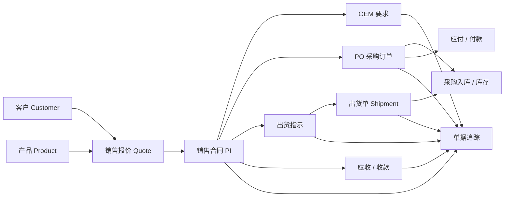
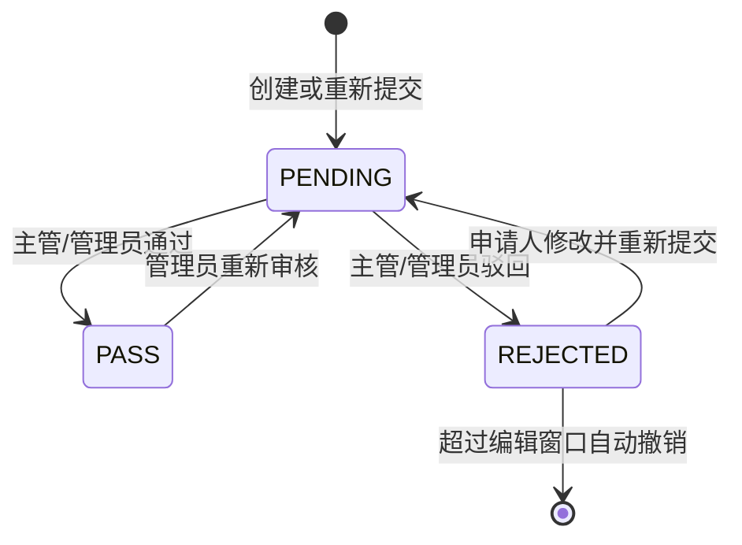

# XeFlow 外贸 ERP 前端重设计 PRD

> 文档状态：重设计基线稿 
> 适用分支：`main`（开源版） 
> 功能基线：现有系统已实现能力，核对日期 2026-07-10 
> 目标读者：产品经理、UI/UX 设计师、前端工程师、后端工程师、测试人员、业务验收人员

## 目录

- [1. 文档目的](#1-文档目的)
- [2. 产品概述](#2-产品概述)
- [3. 重设计目标](#3-重设计目标)
- [4. 用户与角色](#4-用户与角色)
- [5. 业务对象与编号规则](#5-业务对象与编号规则)
- [6. 信息架构](#6-信息架构)
- [7. 全局交互与视觉要求](#7-全局交互与视觉要求)
- [8. 功能需求](#8-功能需求)
- [9. 权限与页面能力矩阵](#9-权限与页面能力矩阵)
- [10. 跨模块联动](#10-跨模块联动)
- [11. 文件与单据输出](#11-文件与单据输出)
- [12. 搜索、筛选与分页](#12-搜索筛选与分页)
- [13. 反馈与异常处理](#13-反馈与异常处理)
- [14. 非功能需求](#14-非功能需求)
- [15. 设计系统交付要求](#15-设计系统交付要求)
- [16. 重设计页面优先级](#16-重设计页面优先级)
- [17. 验收标准](#17-验收标准)
- [18. 设计与开发交付物](#18-设计与开发交付物)
- [19. 待后续评审项](#19-待后续评审项)
- [20. 参考资料](#20-参考资料)

## 1. 文档目的

本文档用于指导 XeFlow 外贸 ERP 的前端整体重设计。重设计的首要目标不是改变业务规则，而是在完整保留现有功能、权限和数据范围的前提下，重新组织信息层级、操作路径、状态反馈和视觉语言，使系统更适合小型外贸销售团队的高频日常使用。

本文档同时承担以下职责：

- 作为新版信息架构、页面原型和视觉设计的统一产品依据。
- 明确每个页面的用户目标、字段、操作、状态和权限边界。
- 约束跨模块业务编号、数据归属、通知、附件和导出单据的一致性。
- 为前端重构、接口联调、测试用例和最终验收提供基线。

文中使用以下标识：

- **必须保留**：系统已经实现，重设计不得遗漏或改变含义。
- **设计要求**：本轮前端重设计需要实现的体验和视觉规则，通常不改变后端业务逻辑。
- **后续扩展**：不作为首版重设计验收条件，需要单独评审后开发。

## 2. 产品概述

### 2.1 产品定位

XeFlow 外贸 ERP 是面向小型外贸销售公司的内部经营管理系统，围绕业务员开发客户和跟进订单的主线，覆盖客户与产品资料、报价、PI 合同、OEM、采购、出货、库存、收付款、报表、内部协作和权限管理。

### 2.2 核心价值

1. 让业务员在一个系统中完成从客户建档到收款跟踪的日常工作。
2. 让销售主管掌握所有业务员的客户、订单、单据进度和业绩，并及时处理销售报价审批。
3. 让财务统一维护收付款、应收应付、账龄和利润数据。
4. 让管理员通过角色、菜单、按钮和数据范围控制系统访问。
5. 让订单关键节点形成可追踪、可导出、可审计的业务链路。

### 2.3 产品边界

本系统服务公司内部员工，不是面向客户或供应商的公开门户。当前不包含生产排程、完整仓库库位管理、供应商门户、客户门户、移动原生应用、会计总账和税务申报。

数据导入模块不属于可见产品范围，保持移除或默认关闭状态；客户、产品、产品报价和收付款页面自身已有的受控 Excel 导入能力不受此限制。

## 3. 重设计目标

### 3.1 体验目标

- **更快定位**：用户进入页面后 3 秒内能识别当前位置、当前数据范围和主要操作。
- **更少跳转**：高频查看、编辑、审核和导出尽量在列表、抽屉或上下文面板内完成。
- **更清晰的业务链**：PI、OEM、PO、出货指示、出货单和收付款之间的关系可被快速理解。
- **更可靠的状态反馈**：草稿、待审核、已确认、已入库、已出货、已结清、驳回和逾期等状态在全系统保持一致。
- **更适合高频办公**：布局安静、紧凑、可扫描，不采用营销页式的大标题、装饰性卡片堆叠或大面积无效留白。
- **权限可感知**：用户应能理解自己为什么能或不能查看、创建、编辑、审核和删除某条数据。

### 3.2 业务目标

- 降低业务员建立客户、报价、PI 和出货单据的重复录入。
- 缩短销售主管发现并处理待审核报价的时间。
- 降低使用隐藏数据库 ID 造成的选错客户、PI 或 PO 风险。
- 提升财务核销和账龄分析的准确性与可读性。
- 提升管理层按业务员查看订单和业绩的效率。

### 3.3 非目标

- 本轮不重写后端业务规则或数据库结构。
- 本轮不新增复杂 CRM 商机阶段、生产制造或会计凭证体系。
- 本轮不以移动端完全替代桌面端为目标。
- 本轮不改变现有 PI、CI、PO、出货指示和出货单模板的业务内容。

## 4. 用户与角色

### 4.1 角色定义

| 等级 | 角色 | 主要职责 | 数据范围 | 关键能力 |
| --- | --- | --- | --- | --- |
| #0 | 超级管理员 `super_admin` | 系统最高管理 | 全部数据 | 全部业务与系统权限；内置 `admin` 账号不可删除或停用 |
| #1 | 管理员 `admin` | 日常系统管理 | 全部数据 | 与超管相同的操作能力，普通管理员账号可管理 |
| #2 | 财务 `finance` | 维护公司资金与账款 | 全部财务数据 | 收付款、应收、应付、财务及利润报表 |
| #3 | 销售主管 `sales_manager` | 管理销售团队 | 全部销售数据 | 查看所有业务员客户和订单、审批报价、查看团队业绩与单据追踪 |
| #4 | 业务员 `salesman` | 开发客户与跟单 | 本人负责或创建的数据 | 自有客户、报价、PI、OEM、PO、出货及个人业绩 |
| #5 | 只读 `readonly` | 最低安全访问 | 管理员分配的可读范围 | 默认无写入能力，按需分配只读入口 |

### 4.2 核心角色旅程

#### 业务员

客户建档 → 选择产品并报价 → 提交需审批的销售报价 → 建立并确认 PI → 维护 OEM/PO/出货指示 → 建立出货单 → 跟踪应收和订单进度 → 查看个人日程与业绩。

#### 销售主管

查看待审核通知 → 审核或驳回报价 → 按业务员查看客户、订单和单据追踪 → 发现逾期或异常订单 → 查看团队销售业绩 → 协助业务员跟单。

#### 财务

查看应收应付概览 → 按 PI/PO 登记收付款 → 查看未结清和逾期账款 → 查看账龄 → 导出流水、对账单和利润报表。

#### 管理员

审核或创建用户 → 分配角色与权限 → 发布公告/经营摘要 → 查看审计日志 → 处理系统配置和异常 → 在需要时参与全部业务操作。

## 5. 业务对象与编号规则

### 5.1 业务对象关系

### 5.2 编号显示原则

- 所有页面中的“客户 ID”必须显示业务可见的 `customerCode/custCode`，例如 `AU9104`，不得展示数据库主键。
- 关联 PI、PO、OEM、出货指示和出货单时，优先展示业务单号和辅助名称，不允许要求用户输入隐藏数据库 ID。
- 产品选择器至少显示产品代码、产品名称、公司型号和工厂型号中的关键组合。
- 单据编号在生成后只读，复制和搜索操作应方便。
- 收款流水号以 `SK` 开头，付款流水号以 `FK` 开头，例如 `SK20260706-92034`、`FK20260706-89526`。
- OEM 单号、PO 单号和出货指示单号由系统自动生成。

### 5.3 数据归属

- 客户、PI 和 OEM 以 `ownerId` 为首要归属。
- 出货指示、出货单和 PO 优先继承关联 PI 的合同担当；无 PI 时归创建人。
- 业务员只能访问本人负责的数据；销售主管、管理员和拥有 `data:all` 的角色可以查看团队或全部数据。
- 所有详情、编辑、删除、附件、下载、导出和核销操作都必须沿用相同的数据范围。

## 6. 信息架构

### 6.1 一级导航

| 一级区域 | 二级页面 | 路由 |
| --- | --- | --- |
| 首页 | 工作台、计划日历、待办 | `/dashboard` |
| 基础资料 | 客户资料 | `/basedata/customer` |
| 基础资料 | 产品资料 | `/basedata/product` |
| 基础资料 | 产品配件资料 | `/basedata/bom` |
| 基础资料 | 汇率管理 | `/basedata/currency` |
| 消息中心 | 内部沟通、通知 | `/message` |
| 销售管理 | 产品报价 | `/sales/standard-price` |
| 销售管理 | 销售报价 | `/sales/contract-price` |
| 销售管理 | 销售合同 PI | `/sales/pi` |
| 销售管理 | 单据追踪 | `/sales/trace` |
| 订单管理 | OEM 要求 | `/order/oem` |
| 订单管理 | PO 采购订单 | `/order/po` |
| 订单管理 | 出货指示 | `/order/shipping-instruction` |
| 出货管理 | 出货单 | `/shipment/list` |
| 库存管理 | 库存查询 | `/inventory/stock` |
| 财务管理 | 收付款 | `/finance/entry` |
| 财务管理 | 应收账款 | `/finance/receivable` |
| 财务管理 | 应付账款 | `/finance/payable` |
| 管理报表 | 采购报表 | `/report/purchase` |
| 管理报表 | 销售报表 | `/report/sales` |
| 管理报表 | 财务利润报表 | `/report/profit` |
| 管理报表 | 业务员业绩 | `/report/salesman` |
| 资料共享 | 文件列表 | `/fileshare` |
| 系统管理 | 用户管理 | `/system/user` |
| 系统管理 | 角色管理 | `/system/role` |
| 系统管理 | 权限菜单 | `/system/permission` |
| 系统管理 | 审计日志 | `/system/audit` |

### 6.2 全局框架

新版仍采用桌面管理系统框架：左侧业务导航、顶部全局栏、主内容区和按需出现的抽屉/对话框。

顶部全局栏必须包含：

- 当前页面面包屑或标题。
- 内部消息入口；有未读消息时仅显示红点。
- 通知入口；有未读通知时显示红点或数量，需与消息入口视觉区分。
- 当前用户头像、昵称和角色入口。
- 个人中心、修改密码和退出登录。

头像规则：上传头像时显示图片；未上传时显示昵称首字符，昵称为空再使用姓名或用户名首字符。

## 7. 全局交互与视觉要求

### 7.1 页面结构

标准业务列表页按以下顺序组织：

1. 页面标题与必要的业务摘要。
2. 查询筛选区。
3. 主操作区，例如新建、导入、导出。
4. 数据表格或业务视图。
5. 分页、合计和批量操作。

页面分区应使用全宽布局和细分隔线，不使用卡片嵌套卡片。重复业务对象可以使用轻量卡片；常规筛选和表格不应被装饰性卡片包围多层。

### 7.2 表格

- 所有表头和单元格默认左对齐，包括数量、金额和状态；报表图表中的坐标轴除外。
- 表头保持单行，字段名不得被裁切；必要时调整列宽或允许表头换行。
- 关键业务编号列固定在左侧，操作列固定在右侧。
- 操作按钮顺序统一为：查看/详情 → 编辑 → 状态动作 → 分享/附件/单据 → 删除。
- 条件性操作不存在时，后续操作自然补位，不保留隐藏占位。
- 一行操作超过 4 个时，保留 1 至 3 个高频操作，其余放入“更多”菜单。
- 表格需支持加载态、空状态、错误态和无权限态，不以空白区域代替反馈。
- 金额展示保留币种；精度按业务字段处理，销售单价最多 4 位、报表金额通常 2 位。

### 7.3 表单

- 业务编号、系统计算字段和自动带入字段使用只读样式，并说明来源。
- 关联对象使用可搜索选择器，不直接输入数据库 ID。
- 必填项同时在标签和校验信息中体现；选填项不滥用红色提示。
- 长表单按“基本信息、关联信息、产品明细、物流信息、金额与条款、备注与附件”分组。
- 新建与编辑使用一致的字段顺序；复杂单据优先使用宽抽屉或独立工作区，简单资料可使用对话框。
- 关闭未保存表单前需要二次确认。

### 7.4 状态系统

| 语义 | 示例 | 建议颜色 |
| --- | --- | --- |
| 中性/未开始 | 草稿、未读、未收、未付 | 灰色 |
| 信息/进行中 | 已确认、部分收、部分付 | 蓝色 |
| 等待处理 | 待审核、待处理、即将到期 | 黄色/琥珀色 |
| 成功完成 | 通过、已入库、已出货、已结清 | 绿色 |
| 风险/失败 | 驳回、逾期、超限、失败 | 红色 |

同一状态在列表、详情、通知、日历和单据追踪中必须使用相同文案和颜色。仅使用颜色不足以表达状态，必须同时显示文字或图标。

### 7.5 响应式与适配

- 主要设计视口：`1440 × 900`，兼容 1366 至 1920 宽度桌面屏。
- 最低完整办公宽度：1280px；低于该宽度时侧边栏可折叠，表格允许横向滚动。
- 1024px 平板支持登录、首页、消息、通知、查看详情和基础审批；复杂单据编辑可横向滚动或切换分组布局。
- 手机端首版只要求登录、消息通知和只读查看可用，不要求承载复杂表格编辑。
- 文字不得与按钮、标签、图标或相邻内容重叠；固定格式控件应有稳定尺寸。

### 7.6 可访问性

- 正文和背景对比度至少满足 WCAG AA。
- 键盘可依次访问筛选、主操作、表格操作和对话框按钮。
- 图标按钮必须有可访问名称和悬停提示。
- 表单错误应聚焦到首个错误字段，不只使用顶部消息提示。
- 删除、审批、入库、核销、注销账户等不可逆或高影响操作必须二次确认。

## 8. 功能需求

## 8.1 登录、注册与个人中心

### 用户目标

安全进入系统，使用用户名密码或邮箱验证码登录；符合配置时完成注册并等待管理员审核；维护个人资料和安全设置。

### 必须保留

- 密码登录：用户名、密码。
- 邮箱验证码登录：邮箱、验证码、发送验证码倒计时。
- 注册入口受后端配置控制。
- 注册可配置注册码、邮箱验证码、邮箱域名白名单和管理员审核。
- 当前试运营规则允许不限制邮箱域名，并可要求注册码和管理员审核。
- 登录连续失败默认最多 5 次，锁定默认 15 分钟。
- 登录成功后返回原目标页面；登录状态失效时回到登录页。
- 个人中心包含个人资料、头像、角色、修改密码和注销账户。
- 管理员待审核的新用户在启用前不可正常使用业务系统。

### 设计要求

- 登录页第一视觉信号为 XeFlow 品牌，而不是通用“ERP 系统”模板。
- 密码登录和验证码登录使用清晰标签页；切换后保留合理输入，不误提交另一模式字段。
- 注册流程按配置动态显示注册码和邮箱验证码，不展示无效字段。
- 登录失败区分凭据错误、账号停用、等待审核、暂时锁定和网络失败。
- 密码输入支持显示/隐藏，但默认隐藏。
- 修改密码和管理员重置密码的规则文案保持一致；当前系统基线为 6 至 32 位，后续若升级强密码规则需同步前后端。

## 8.2 首页工作台与计划日历

### 用户目标

快速掌握今日事项、逾期事项、未读消息以及与本人订单相关的关键日期，并维护个人日程。

### 页面内容

- 欢迎信息：昵称/姓名、日期、角色。
- 指标：今日待办、已逾期、待办总数、未读消息。
- 月历：展示手工日程和系统生成事项。
- 我的待处理事项：按日期、时间和优先级展示。
- 日程详情抽屉：查看选中日期的全部安排。

### 日程字段

| 字段 | 规则 |
| --- | --- |
| 标题 | 必填，最多 100 字 |
| 日期 | 必填，默认选中日期或今天 |
| 全天 | 开关；关闭后必须填写开始和结束时间 |
| 开始/结束时间 | 结束时间必须晚于开始时间 |
| 地点 | 选填，最多 100 字 |
| 优先级 | 低、中、高 |
| 详情 | 选填，最多 500 字 |
| 状态 | 待处理、已完成；支持恢复 |
| 来源 | 手动、PI 交货、出货指示、出货单 |

### 必须保留

- PI 交货日期、出货指示日期和出货单日期可自动进入日历。
- 系统生成事项与手工事项有视觉区别。
- 上月和下月日期使用浅色，仍可点击查看。
- 月历单日最多预览 3 条，更多内容显示数量并进入当日详情。
- 逾期事项有风险提示；已完成事项弱化并加删除线。

### 设计要求

- 日历是首页主工作区，不应被过多装饰卡片压缩。
- 当日详情采用时间轴或日程列表，全天事项置顶，定时事项按开始时间排序。
- 点击指标可进入对应筛选状态；未读消息跳转消息中心。
- 自动事项应提供来源单据链接，权限不足时仅显示无权访问提示。

## 8.3 客户资料

### 用户目标

建立并维护客户完整档案，使用业务客户 ID 搜索、引用、导出和关联销售单据。

### 查询与列表

- 关键字支持客户 ID、公司名称、联系人、国家等。
- 列表至少展示客户 ID、公司名称、联系人、国家、币种、联系方式、负责人和创建时间。
- 业务员仅见本人客户；销售主管与管理员可见全部并按负责人筛选。

### 客户字段

- 客户 ID `custCode`、公司名称、国家、币种。
- 联系人姓名、职位、联系电话、电子邮箱、社媒联系方式。
- 网站、地址、中文名、英文名。
- 营业执照、税号、银行名称、银行账户、信用额度。
- 备注。
- 自定义“键/值”字段；键输入框占位文字为“键”。
- 客户附件：文件名、大小、上传人、备注、上传时间。

### 操作

- 新建、查看资料、编辑、删除。
- 导入、下载模板、按筛选结果导出。
- 导出中英双语客户资料 Word。
- 上传、下载、删除客户附件。

### 设计要求

- 列表中的客户 ID 始终显示 `custCode`，任何关联选择器也必须如此。
- 客户详情建议使用分区详情页或宽抽屉：基本资料、联系方式、财务与银行、其他资料、附件、关联单据。
- 敏感银行信息对无财务或管理权限的角色应按权限隐藏或掩码。
- 删除客户前展示关联 PI/报价数量；存在强关联时优先阻止删除并提示原因。

## 8.4 产品资料

### 用户目标

维护公司产品、公司型号、工厂型号、成本和安全库存，为报价、PI、OEM、PO 和库存提供统一来源。

### 字段

- 产品代码/产品 ID、产品名称、中文名、英文名。
- 公司型号、工厂型号、规格、单位。
- 工厂价、成本价、币种、安全库存。
- 备注、创建时间。

### 操作

- 查询、新建、编辑、删除。
- Excel 导入、下载模板、导出。
- 产品选择器被报价、PI、OEM、PO 和库存复用。

### 设计要求

- 产品代码、公司型号和工厂型号在视觉上分层清晰，避免均显示为“型号”。
- 金额字段同时显示数值和币种。
- 列表可突出低于安全库存的产品，但不在产品资料页重复完整库存流水。

## 8.5 产品配件资料（BOM）

### 用户目标

维护产品与配件/物料之间的关系、适用型号和供应商信息。

### 字段与筛选

- BOM 编号、关联产品、产品代码、中英文名称、版本。
- 适用型号、是否通用、规格、数量。
- 供应商、联系人、电话、单价、币种、总价、备注。
- 支持关键字、适用型号和“仅看通用”筛选。

### 操作

新建、详情、编辑、删除。详情需清晰呈现 BOM 基本信息和明细物料。

## 8.6 汇率管理

### 用户目标

维护外币兑本位币汇率，执行金额换算，并支持报表口径。

### 必须保留

- 本位币显示。
- 按币种和日期换算金额。
- 汇率列表、有效日期和备注。
- 新增、编辑、删除汇率。
- 从在线服务拉取当日汇率并显示成功/失败结果。

### 设计要求

- 明确汇率方向，例如“1 USD = x CNY”，避免只显示无语义数字。
- 在线更新属于高影响批量动作，执行前说明日期和覆盖规则，完成后展示结果摘要。

## 8.7 产品报价

### 用户目标

维护面向产品的标准单价、折扣单价和底价，为销售报价和 PI 价格选择提供基线。

### 字段

- 产品、产品代码、产品名称、公司型号。
- 标准单价、折扣单价、底价、币种。
- 可选客户、有效日期、备注。

### 操作

查询、新建、编辑、删除、Excel 导入、下载模板、导出。

### 设计要求

- 三种价格按“标准 → 折扣 → 底价”的顺序展示，禁止仅靠颜色区分。
- 编辑时实时校验价格关系；异常关系给出明确提示。
- 产品选择后自动带入产品信息，减少重复输入。

## 8.8 销售报价

### 用户目标

业务员为指定客户和产品提交成交单价；系统计算相对基准价的偏差，必要时由销售主管或管理员审核。

### 字段

- 报价编号、申请人、客户 ID、客户名称。
- 产品 ID、产品名称、产品型号、产品代码。
- 成交单价、标准价、偏差率、币种、备注。
- 审核状态、审核人、审核时间、驳回原因和驳回编辑剩余时间。

### 状态与操作

- `PENDING`：待审核，可由有审批权限的用户通过或驳回。
- `PASS`：已通过，普通业务员不可继续编辑。
- `REJECTED`：已驳回，申请人在限定时间内可重新编辑；超时自动撤销。
- 销售主管和管理员可重新置为待审核。
- 普通业务员只能编辑或撤销本人报价。

### 通知规则

- 待审核通知仅发送给销售主管、管理员和超级管理员。
- 通知类型统一显示“系统”。
- 文案格式：`{申请人}申请的销售报价（报价编号：{报价编号}）正在等待销售主管的审核。`
- 审核结果通知发送给报价申请人。

### 设计要求

- 待审核列表突出申请人、报价编号、客户、产品、成交价、偏差率和等待时间。
- 审批操作在不离开上下文的侧栏/对话框内完成，并展示标准价、底价和历史状态。
- 驳回必须填写原因；驳回倒计时应清晰但不制造过度视觉噪声。

## 8.9 销售合同 PI

### 用户目标

建立销售合同及产品明细，引用已审核销售报价或标准价格，确认合同并生成 PI/CI 单据。

### 主表字段

- PI 单号、合同担当、客户 ID、客户名称、币种、总金额。
- 状态、签约日期、交货日期。
- 付款方式、贸易条款、目的港、唛头、备注。

### 明细字段

- 产品 ID、产品代码、产品名称、产品型号、工厂型号、单位。
- 报价来源、关联报价 ID。
- 标准价、折扣价、底价、数量、成交单价、金额、备注。

### 状态

- 草稿 `DRAFT`。
- 已确认 `CONFIRMED`。
- 已出货 `SHIPPED`。
- 已关闭 `CLOSED`。

### 操作

- 新建、查看、编辑、删除。
- 草稿确认。
- 生成 PI 模板单据、CI 商业发票。
- 按数量和日期执行出货动作并生成后续记录。

### 业务规则

- 仅允许引用当前用户可见客户和产品。
- 报价来源应明确标识为销售报价、标准单价、折扣单价或底价。
- 未通过的销售报价不得作为可用成交价来源。
- 总金额由明细金额汇总，不允许主表与明细不一致。
- 已确认后的关键合同字段需要受限编辑或给出高风险确认。

### 设计要求

- PI 编辑应采用主从单据布局，明细表支持快速增加、复制和删除行。
- 在单据头部固定显示 PI 单号、客户、担当、状态、金额和主要操作。
- 明细行选择产品后，价格来源和基准价以可比较方式展示。
- 生成 PI/CI 作为“单据”操作组，不与删除混排。

## 8.10 单据追踪

### 用户目标

围绕 PI 查看产品明细、合同担当以及出货指示、出货单和收付款等关键事件。

### 必须保留

- PI 选择器显示 PI 单号、客户、合同担当和签约日期。
- 销售主管、管理员可按合同担当筛选；业务员仅能看到本人。
- 摘要显示 PI 单号、合同担当、客户 ID、客户、合同金额、状态、签约/交货日期、付款方式和贸易条款。
- PI 明细展示产品、型号、数量、单价、金额和报价来源。
- 时间线展示节点类型、业务单号、日期、状态和摘要。

### 设计要求

- 将页面设计为“订单驾驶舱”：左侧/顶部选择 PI，中部显示关键摘要，主区域显示可点击业务链。
- 时间线节点可跳转对应详情；没有权限时显示不可访问原因。
- 主管视角的担当筛选常驻且可搜索，显示各担当的 PI 数量作为增强项。

## 8.11 OEM 要求

### 用户目标

记录客户针对产品的 OEM 要求，并通过附件保存图纸、标签、包装或其他资料。

### 字段

- OEM 单号，自动生成。
- 关联 PI 单号、客户 ID、客户名称。
- 产品 ID、产品型号、工厂型号。
- OEM 要求、状态、创建时间。

### 状态

- 草稿：灰色状态框。
- 已确认：绿色状态框。

### 附件

- 每条 OEM 可上传多个附件。
- 单文件最大 50MB。
- 显示文件名、大小、上传人、备注和上传时间。
- 支持上传、下载、删除。

### 边界

- OEM 页面不提供导入、导出和下载模板。
- 客户 ID 必须显示业务客户编号，例如 `AU9104`。

### 设计要求

- OEM 要求正文和附件应在同一详情上下文内，不使用独立无关联文件页。
- 产品/PI/客户信息自动带入并标记来源，减少手工修改错误。

## 8.12 PO 采购订单

### 用户目标

依据 PI 和采购需求向供应商建立采购订单，维护采购明细，执行到货入库并生成 PO 单据。

### 字段

- PO 单号，自动生成。
- 关联 PI 单号、供应商、采购明细摘要。
- 币种、合计金额、状态、下单日期、备注。
- 明细：产品、产品代码、数量、采购单价、金额。

### 状态与规则

- 草稿：可编辑。
- 已入库 `RECEIVED`：状态不可再编辑，不能再次执行到货入库。
- 到货入库动作应同步库存流水。
- 已入库行不显示“到货入库”按钮，后续分享、PO 单据、删除等操作自然补位。

### 操作

新建、编辑、到货入库、分享系统数据、生成 PO 模板单据、删除。

### 设计要求

- 列表在供应商之后展示采购明细，至少包含产品和数量摘要。
- 到货入库为高影响操作，需要确认采购明细与数量。
- 操作列保持单行或使用更多菜单，所有行对齐，不预留隐藏按钮宽度。

## 8.13 出货指示

### 用户目标

依据 PI 快速生成给仓库或物流使用的出货指示，并按指定 Excel 模板导出。

### 字段

- 出货指示单号，自动生成。
- 关联 PI 单号，选填。
- 出货日期、发货物流地址、送货地址。
- 联系人、电话。
- 订单编号、订单国家。
- 产品型号、工厂型号、数量、箱数。
- 订单要求、备注、负责人、下单日期。

### 业务规则

- 关联 PI 后自动带入客户、订单、产品、数量、联系人、地址、负责人和下单日期等可用信息。
- 关联 PI 不是必填项；无 PI 时允许手工完成必要字段。
- 箱数默认与数量一致，但数量和箱数均可编辑并正确显示。
- 导出的出货指示使用系统指定空白模板样式。

### 边界

- 页面不提供通用导入、下载模板和通用导出按钮。
- 单条记录操作中保留“指示单”模板导出。

## 8.14 出货单

### 用户目标

记录最终出货确认和装箱信息，并生成出货确认单和装箱单。

### 字段

- 出货单号，对应导出文档 Reference Number。
- 关联出货指示、关联 PI。
- 出货日期、数量、箱数。
- 毛重、净重、体积 CBM。
- 柜型、柜号、提单号、状态、备注。
- 导出文档中的 Customer ID 使用客户 `custCode`。

### 状态与操作

- 草稿、已出货。
- 新建、编辑、删除。
- 生成模板化出货单。
- 生成中英双语装箱单。

### 边界

- 页面不显示通用导入、下载模板和通用导出按钮。
- 导出单据品牌头使用 XeFlow 图片标识，而不是纯文字。

### 设计要求

- 关联对象使用业务单号选择，不显示 `PI_ID` 或 `出货指示ID` 等数据库术语。
- 重量、体积、箱数按“包装与装运”分组展示。

## 8.15 库存查询

### 用户目标

查看各产品当前结存、安全库存和预警，并维护受控出入库流水。

### 列表与筛选

- 关键字：产品代码/名称。
- 仅看预警。
- 产品代码、名称、单位、当前结存、安全库存、预警状态。

### 出入库登记

- 方向：入库、出库。
- 数量。
- 业务类型：手工、采购入库、销售出库、生产领料、盘点调整。
- 关联单据、日期、备注。
- 支持查看指定产品的历史流水。

### 设计要求

- 低库存使用明确风险标识并提供快速筛选。
- 当前结存和安全库存并列可比较；可增加差额显示，但不改变现有数据口径。

## 8.16 收付款

### 用户目标

维护公司收款与付款流水，按客户、类型、日期和关联单据查询，并汇总资金方向。

### 类型

- 应收、应付。
- 预收定金、预付定金。
- 应收未收、应付未付。

### 字段

- 自动流水号、类型、方向。
- 客户 ID `customerCode`。
- 金额、币种。
- 关联单据类型、关联单据号。
- 入账日期、备注、创建时间。

### 操作

查询、重置、新建、编辑、删除、导入、下载模板、导出。

### 业务规则

- 收款自动生成 `SK` 开头流水号，付款自动生成 `FK` 开头流水号。
- 根据类型自动带出收/付方向，用户不应轻易产生类型与方向矛盾。
- 客户引用使用 `customerCode`，关联 PI/PO 使用业务单号。

### 设计要求

- 顶部摘要展示各类型金额与笔数，但不使用过多独立装饰卡片。
- 收与付同时使用文字、图标和颜色区分。

## 8.17 应收账款

### 用户目标

按 PI 查看应收、已收、未收和账龄，登记客户回款。

### 内容

- 汇总：应收合计、已收合计、未收余额、逾期余额、PI 数、未结清数。
- 列表：PI 单号、客户 ID、客户名称、币种、签约日、应收、已收、未收、账龄、状态。
- 状态：未收、部分收、已结清。
- 筛选：PI/客户、客户、状态、仅逾期、账期天数。
- 客户账龄：0-30、31-60、61-90、90 天以上、余额、信用额度、是否超限。
- 登记收款：金额、日期、备注，必须校验 PI 存在且用户有权访问。

## 8.18 应付账款

### 用户目标

按 PO 查看应付、已付、未付和账龄，登记供应商付款。

### 内容

- 汇总：应付合计、已付合计、未付余额、逾期余额、PO 数、未结清数。
- 列表：PO 单号、供应商、币种、下单日、应付、已付、未付、账龄、状态。
- 状态：未付、部分付、已结清。
- 筛选：PO/供应商、供应商、状态、仅逾期、账期天数。
- 供应商账龄：0-30、31-60、61-90、90 天以上和余额。
- 登记付款：金额、日期、备注，必须校验 PO 存在且用户有权访问。

## 8.19 管理报表

### 采购报表

- 按日、周、月、年和日期范围统计采购额。
- 同时提供图表、明细表和 Excel 导出。

### 销售报表

- 按日、周、月、年和日期范围统计销售额。
- 同时提供图表、明细表和 Excel 导出。

### 财务利润报表

- 对比销售额、采购额和利润。
- 展示汇总指标、组合图表和明细表。
- 支持 Excel 导出、外贸业绩报告 Word、按客户 ID 和月份生成销售月对账单。

### 业务员业绩

- 按 PI 合同担当归属汇总业务员、PI 单数、销售额和占比。
- 支持日期范围筛选。
- 仅销售主管、管理员或拥有 `data:all` 的角色查看团队横向对比。
- 业务员只查看自己的业绩时，不暴露其他业务员数据。

### 设计要求

- 报表必须先说明统计口径、日期范围和币种口径。
- 当前业务员业绩为 PI 原币金额合计，未做币种换算；界面必须保留该提示，后续可扩展本位币口径。
- 图表颜色与状态色体系协调，但不让装饰颜色掩盖数据比较。

## 8.20 消息中心

### 内部沟通

- 联系人搜索支持姓名、昵称、邮箱、电话。
- 联系人列表展示头像、名称、角色和未读数量。
- 未读数字角标显示在联系人头像右上角。
- 顶部消息中心信封仅显示红点，不显示数字。
- 联系人资料不显示账号字段，只显示姓名、昵称、邮箱、电话和角色。
- 支持文本消息、附件、删除本人视图中的单条消息和清空聊天记录。
- 一次最多选择 9 个附件，消息内容最多 2000 字。
- 消息默认保留 14 天，过期自动清理。
- 空状态文案：`还没有消息，发送第一条吧 👋`。

### 分享系统数据

- 支持在聊天中分享结构化系统数据，目前至少包括产品和 PO 采购订单。
- 分享卡片显示业务名称、摘要和可访问操作。
- 接收人有权限时可跳转目标页面；无权限时显示“无权访问”，不得绕过后端数据范围。
- 功能名称统一为“分享系统数据”。

### 设计要求

- 桌面端采用联系人、会话、上下文信息的双栏或三栏布局。
- 当前联系人、未读联系人和普通联系人状态清晰，但避免高饱和大面积背景。
- 消息气泡宽度、附件卡片和结构化数据卡片适合中英文长内容。

## 8.21 通知与公告

### 通知类型

- 系统：销售报价待审核、审核结果和其他业务通知。
- 报表：经营周报/月报。
- 公告：管理员发布的内部公告。

### 用户操作

- 全部/未读筛选。
- 单条查看并自动标记已读。
- 批量选择已读、全部已读。
- 管理员可删除、发布公告、发送经营摘要。

### 管理员操作

- 公告可发送给全部用户或指定用户。
- 可选同时发送邮件，依赖 SMTP 配置。
- 周报/月报支持默认周期或自定义日期范围、预览和发送。

### 安全与展示

- 普通通知按纯文本展示，不执行用户输入的 HTML。
- 报表 HTML 仅允许白名单标签和必要表格属性。
- 通知表格不显示空白列。
- 销售报价待审核通知只发给销售主管和管理员角色。

## 8.22 资料共享

### 用户目标

在团队内临时共享文件，并通过有效期自动清理过期数据。

### 列表与查询

- 一个搜索框同时搜索文件名、分类、格式和上传人。
- 列表顺序：文件名、分类、格式、大小、上传人、描述、上传时间、过期时间、操作。
- “大小”与其他表头和内容一样左对齐。

### 上传字段与规则

- 文件：拖拽或点击选择，云朵图标和提示文字在上传区域水平、垂直居中。
- 分类：内置于上传对话框，未填显示“无”。
- 格式：根据文件后缀自动获取。
- 描述：选填，最多 255 字。
- 有效时长：24 小时、7 天、15 天、30 天、90 天、180 天或自定义。
- 自定义有效期最高 180 天；默认 30 天。
- 单文件最大 50MB。
- 过期文件自动删除并清理物理文件。

### 设计要求

- 上传对话框左侧为稳定尺寸拖拽区，右侧为分类、有效期和描述；窄屏改为上下布局。
- 选择文件后显示名称、格式、大小和更换/移除操作。
- 距离过期较近时显示柔和提醒，已过期数据不应继续出现在列表。

## 8.23 用户管理

### 用户目标

管理员查询、创建、编辑、启停、分配角色、重置密码和删除用户，并处理待审核注册用户。

### 字段

- 用户名、姓名、昵称、邮箱、手机号。
- 角色、状态、备注、创建时间。
- 新建时设置初始密码；编辑留空表示不修改密码。

### 规则

- `admin` 超级管理员账号不可删除或停用。
- 超级管理员角色仅限受保护账号使用。
- 管理员账号可以管理，但不得破坏系统至少一个可用最高权限账号的安全底线。
- 停用用户无法登录。
- 待审核用户需要管理员启用和分配合适角色。

## 8.24 角色管理

### 用户目标

维护角色名称、标识、排序和状态，并按菜单/按钮树分配权限。

### 必须保留

- 角色列表、新建、编辑、删除。
- 分配权限树。
- 内置超级管理员和管理员角色的标识与启用状态受保护。
- 已被用户使用的角色删除前必须解除分配。

### 设计要求

- 角色权限分配应同时展示“页面入口”和“页面内操作”，避免只有技术权限标识。
- 提供全选、半选、展开/收起和按模块定位。
- 明确提示权限变化对现有用户的影响。

## 8.25 权限菜单

### 用户目标

管理员维护目录、菜单和按钮权限元数据。

### 字段与操作

- 上级、类型（目录/菜单/按钮）、名称、权限标识。
- 路由、组件、图标、排序、状态。
- 新建顶级、添加下级、编辑、删除。

### 设计要求

- 这是高风险技术管理页，应与普通角色管理区分，并显示更明确的风险确认。
- 删除前展示受影响角色和子级；存在子级时阻止删除。

## 8.26 审计日志

### 用户目标

管理员按人员、模块、结果和日期追踪系统操作，排查错误和安全问题。

### 内容

- 操作人、模块、操作、HTTP 方法、请求地址。
- 结果、耗时、IP、时间。
- 详情：目标方法、请求参数、错误信息。

### 安全要求

- 密码、旧密码、新密码、token、验证码、注册码等字段显示为 `******`。
- 上传文件对象只显示必要摘要，不序列化文件内容。
- 日志详情支持复制技术信息，但默认折叠长参数。

## 9. 权限与页面能力矩阵

符号：`管`=全量管理，`全读`=查看全部，`自管`=管理本人数据，`读`=按分配只读，`审`=审批，`-`=默认无权限。

| 模块 | 超管/管理员 | 销售主管 | 财务 | 业务员 | 只读 |
| --- | --- | --- | --- | --- | --- |
| 首页/个人日程 | 管 | 自管 | 自管 | 自管 | 自管 |
| 客户资料 | 管 | 全读/可协助 | 按需读 | 自管 | 读 |
| 产品/BOM | 管 | 全读 | 按需读 | 读/按授权维护 | 读 |
| 汇率 | 管 | 读 | 管 | 读 | 读 |
| 产品报价 | 管 | 全读/按授权维护 | 读 | 读/按授权维护 | 读 |
| 销售报价 | 管/审 | 全读/审 | - | 自管 | 读 |
| PI/单据追踪 | 管 | 全读 | 财务相关读 | 自管 | 读 |
| OEM/PO/出货指示/出货单 | 管 | 全读/协助 | 按需读 | 自管 | 读 |
| 库存 | 管 | 读 | 读 | 读/按授权登记 | 读 |
| 收付款/应收/应付 | 管 | 销售汇总读 | 管 | 本人业务相关读 | 读 |
| 管理报表 | 管 | 销售/业绩全读 | 财务报表全读 | 个人相关读 | 读 |
| 消息/资料共享 | 管 | 自用 | 自用 | 自用 | 自用/按授权 |
| 用户/角色/权限/审计 | 管 | - | - | - | - |

最终能力由后端权限键和数据范围共同决定。前端隐藏按钮只是体验层，不能代替服务端鉴权。

## 10. 跨模块联动

### 10.1 自动带入

- 销售报价选择客户和产品后带入可用名称、型号和基准价格。
- PI 选择客户、产品和报价来源后带入客户、产品及价格信息。
- OEM 选择 PI 后带入客户和产品信息。
- PO 选择 PI 后带入 PI 单号和可采购产品。
- 出货指示选择 PI 后带入订单、客户、联系人、产品、数量和负责人。
- 出货单选择出货指示或 PI 后带入关联信息。
- 应收和应付分别从 PI 和 PO 汇总，并生成收付款流水。

### 10.2 自动事件

- PI 交货日期进入个人日历。
- 出货指示和出货单日期进入个人日历。
- 销售报价待审核产生指定角色通知。
- 报价审核结果通知申请人。
- PI、出货指示、出货单和收付款进入单据追踪时间线。
- PO 到货入库产生库存流水。

### 10.3 深层链接

从通知、日历、消息分享卡片、报表明细和单据追踪进入业务对象时，应携带业务上下文并直接定位目标记录；无权限时不泄露详情。

## 11. 文件与单据输出

| 来源 | 输出 | 要求 |
| --- | --- | --- |
| 客户资料 | 客户资料表 Word | 中英双语、业务客户 ID |
| 销售 PI | PI Excel | 使用指定 PI 空白模板 |
| 销售 PI | CI Excel | 使用指定 CI 空白模板 |
| PO | PO Excel | 使用指定 PO 空白模板 |
| 出货指示 | 出货指示 Excel | 使用指定出货指示模板 |
| 出货单 | 出货确认 Excel | Reference Number、Date、Customer ID 等符合模板 |
| 出货单 | 装箱单 Word | 中英双语 |
| 财务利润 | 销售月对账单 Word | 按客户 ID 与月份 |
| 财务利润 | 外贸业绩报告 Word | 按日期范围 |
| 报表 | Excel | 按当前筛选条件 |

下载过程中显示明确进度或加载状态；失败时保留当前页面和筛选条件。文件名使用业务编号，避免无意义时间戳。

## 12. 搜索、筛选与分页

- 查询条件应保留到用户离开当前模块前；从详情返回列表时恢复页码、排序和筛选。
- 关键字输入支持 Enter 查询，重置后立即回到第一页。
- 可枚举状态使用选择器，不要求用户输入状态文本。
- 合同担当、客户、产品和供应商筛选支持搜索。
- 页面大小统一为 10、20、50、100。
- 无结果时展示当前筛选摘要和“清除筛选”，不只显示空图。
- 主管和管理员的“全部业务员”是明确选项；普通业务员不显示无意义的担当筛选。

## 13. 反馈与异常处理

### 13.1 统一反馈

- 保存成功：在操作上下文中反馈，并刷新受影响数据。
- 校验失败：字段下方说明问题，保留已填写内容。
- 网络失败：显示“请求失败”时同时提供重试，不把所有异常统一成“系统繁忙”。
- 权限失败：明确“无权查看/操作该数据”，不表现为数据不存在。
- 业务对象不存在：显示对应业务编号和可能原因。
- 导出失败：提示模板、数据或服务端原因，允许重试。

### 13.2 页面状态

每个页面都必须设计：首次加载、局部刷新、空数据、筛选无结果、接口错误、无权限、删除确认、保存中、保存成功和并发状态已变化。

### 13.3 防重复提交

新建、保存、审批、入库、登记收付款、发送公告和上传文件在请求完成前禁用重复操作。

## 14. 非功能需求

### 14.1 性能

- 首屏框架应快速出现，业务列表使用骨架或局部加载，不长时间整页遮罩。
- 常规筛选和翻页目标响应时间 2 秒内；超过 2 秒显示持续加载反馈。
- 大表格保持分页，不一次渲染全部数据。
- 图片和品牌资源按实际显示尺寸加载，避免明显模糊或过大。

### 14.2 安全

- Token 不出现在 URL、日志或可复制业务字段中。
- 通知、消息、备注和客户/产品文本默认按纯文本渲染。
- 文件下载路径需服务端规范化并限制在上传目录。
- 危险后缀被阻止，下载响应使用 `nosniff`。
- 前端不缓存密码、验证码和注册码。
- 退出登录后清理会话和受保护页面状态。

### 14.3 兼容性

- 支持最新版 Chrome、Edge。
- 系统使用中文界面，业务单据保留必要英文术语，例如 PI、CI、PO、OEM、CBM。
- 日期统一 `YYYY-MM-DD`，日期时间统一 `YYYY-MM-DD HH:mm:ss`。
- 金额必须显示币种，避免不同币种直接比较造成误解。

### 14.4 可维护性

- 使用统一设计令牌管理颜色、间距、字号、边框、圆角和层级。
- 业务状态、权限动作、空状态和错误状态使用共享组件。
- 同一字段在不同页面使用一致名称，例如客户 ID、合同担当、出货日期。
- 新设计不得把后端业务编号替换为数据库 ID。

## 15. 设计系统交付要求

设计阶段至少交付以下基础组件及状态：

- 应用框架：展开/折叠侧栏、顶部栏、面包屑、个人菜单。
- 查询栏：输入、选择、日期范围、重置、展开更多条件。
- 表格：普通、固定列、空态、加载、错误、批量选择、分页。
- 状态标签：全部业务状态及浅色/深色模式。
- 操作区：主按钮、图标按钮、更多菜单、危险操作。
- 表单：文本、金额、业务对象选择、日期、时间、开关、附件、明细表。
- 弹层：对话框、宽抽屉、确认框、详情侧栏。
- 通知：顶部红点、列表未读、消息头像数字角标。
- 文件：拖拽上传、附件列表、下载和过期状态。
- 数据展示：统计值、趋势图、账龄分段、单据时间线。

组件设计需覆盖默认、悬停、聚焦、禁用、加载、错误、成功和无权限状态。

## 16. 重设计页面优先级

### P0：核心业务闭环

1. 全局框架与导航。
2. 首页工作台与日历。
3. 客户资料。
4. 销售报价审批。
5. 销售合同 PI。
6. 单据追踪。
7. PO 采购订单。
8. 出货指示与出货单。
9. 应收、应付与收付款。

### P1：高频支撑

1. 产品资料、产品报价、OEM。
2. 消息中心与通知。
3. 库存查询。
4. 业务员业绩和财务利润报表。
5. 资料共享。

### P2：管理与低频配置

1. BOM、汇率、采购报表、销售报表。
2. 用户、角色、权限菜单、审计日志。
3. 登录注册与个人中心的完整视觉统一。

优先级表示设计和实施顺序，不表示 P2 页面可以遗漏。

## 17. 验收标准

### 17.1 功能覆盖

- 本文信息架构中的所有可见页面均有高保真设计和前端实现。
- 每个页面现有查询、查看、新建、编辑、状态动作、附件、导入导出和删除能力均被保留。
- 数据导入模块不重新出现在导航中。
- OEM、出货指示和出货单页面不恢复已明确删除的通用导入/模板按钮。

### 17.2 业务正确性

- 所有客户 ID 使用 `custCode/customerCode`。
- 业务员无法查看或操作其他业务员数据。
- 销售主管可以按业务员查看客户、PI、单据追踪和业绩，并审批销售报价。
- 财务可以查看全部流水、应收应付并登记收付款，但不能审批销售报价。
- PO 已入库后不可再次更改入库状态。
- 销售报价状态、通知对象和通知文案符合本 PRD。
- 自动编号、模板导出、日历自动事件和单据追踪链路正常。

### 17.3 视觉与交互

- 1440×900 和 1366×768 下无文字遮挡、按钮重叠或关键操作不可见。
- 所有表头和单元格按规则左对齐。
- 操作列在不同状态下无隐藏占位，后续按钮自动补位。
- 同一状态在所有页面文案和颜色一致。
- 页面具备加载、空、错误、无权限和筛选无结果状态。
- 无头像用户使用昵称首字符作为默认头像。
- 顶部内部消息入口只显示红点，联系人头像显示未读数量。

### 17.4 安全与权限

- 仅隐藏按钮不能绕过服务端权限。
- 通知和消息中的恶意 HTML 不执行。
- 审计日志中的敏感参数均已脱敏。
- 附件和单据下载遵循数据范围。

### 17.5 测试账号矩阵

使用超级管理员、管理员、财务、销售主管、两名不同业务员和只读用户分别验收菜单、按钮、数据范围、通知和跨模块跳转。Alice 业务员不能访问 Bob 的客户、PI、OEM、PO、出货指示、出货单、附件或核销数据。

## 18. 设计与开发交付物

### 18.1 产品与设计

- 产品地图和角色任务流。
- 全局导航与页面层级。
- P0/P1/P2 页面线框图。
- 1440×900 高保真主稿及 1366×768 适配稿。
- 核心复杂页面的 1024px 适配说明。
- 设计令牌、组件库和完整状态规范。
- 销售报价审批、PI 编辑、单据追踪、PO 入库、收付款核销的交互原型。

### 18.2 开发

- 新版前端组件和页面实现。
- 保留现有路由、接口、权限键和业务语义，确需调整时建立映射和迁移说明。
- 对关键流程补充前端自动化测试。
- 更新用户文档和模块截图。

### 18.3 测试

- 页面与角色权限矩阵。
- 核心业务闭环回归。
- 单据模板下载校验。
- 多视口视觉回归。
- 错误、空数据、弱网、无权限和超时场景。

## 19. 待后续评审项

以下能力适合作为后续版本，不纳入本轮前端重设计必做范围：

- 全局跨模块搜索。
- 客户和订单的操作历史时间线。
- 销售主管直接分配/转移客户和 PI 合同担当的专用工作流。
- 报价审批规则可视化配置。
- 多币种统一折算后的业务员业绩。
- 可配置首页组件和个人常用筛选。
- 移动端完整单据审批。
- 浏览器、邮件和日历的外部提醒集成。

## 20. 参考资料

- [模块与截图索引](modules.md)
- [用户使用指南](user-guide.md)
- [角色与数据权限](security-rbac.md)
- [系统架构](architecture.md)
- [API 说明](api.md)
- [部署指南](deployment.md)

本 PRD 是前端重设计的产品基线。设计过程中发现现有页面与本文存在冲突时，应先确认业务规则，再更新 PRD、设计稿和验收用例，避免只在视觉稿中形成未记录的新规则。
