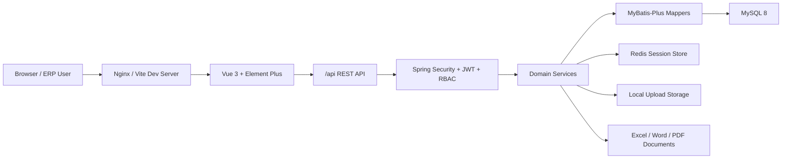
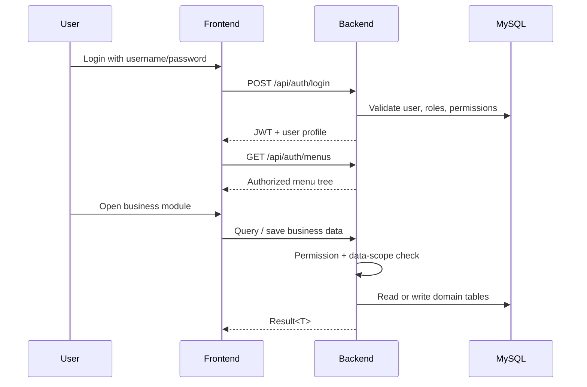

# Architecture

XeFlow 采用前后端分离架构。前端负责交互、路由和按钮权限展示，后端负责认证、RBAC、业务数据权限、审计和单据生成。

## Backend Layers

- `common`: unified response, exception handling, security helpers, data access guard, audit logging, file storage, Excel and document utilities.
- `system`: login, registration, users, roles, permissions, menu tree and audit logs.
- `basedata`: customer, product, BOM, currency and customer attachments.
- `sales`: standard price, sales quote approval and sales PI.
- `order`: OEM requirements, PO purchase orders and shipping instructions.
- `shipment`: shipment records and export documents.
- `finance`: finance entries, receivable and payable workflows.
- `report`: purchase, sales, profit and salesman performance reports.

## Frontend Layers

- Static business routes live under `erp-frontend/src/router`.
- Sidebar menus are loaded from `/auth/menus` and are driven by backend permissions.
- Button visibility is controlled by the frontend permission directive and must still be enforced by backend `@PreAuthorize`.
- API clients live in `erp-frontend/src/api`; pages live in `erp-frontend/src/views`.

## Data Flow

## Storage

- MySQL stores business data, RBAC data, audit logs and document metadata.
- Redis stores login sessions in production or multi-instance deployments.
- Local upload directories store shared files, customer attachments, OEM attachments and generated document assets.
- File download code normalizes paths and checks that the final path remains under the configured upload root.

## Security Boundaries

- Authentication: JWT in `Authorization: Bearer <token>`.
- Authorization: role permissions from `sys_role_permission`, plus backend method-level checks.
- Data scope: normal sales users can only access their own customer and sales-order data; supervisors and administrators can view sales-wide data.
- Audit: sensitive request fields such as passwords, tokens and verification codes are masked before persistence.
