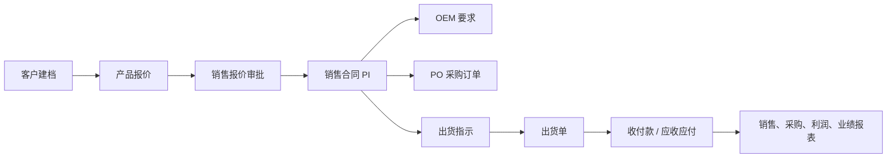

# User Guide

This guide follows the normal work of a small foreign-trade sales company: develop customer, quote, sign PI, prepare OEM/PO, ship goods, register finance entries and review reports.

## 1. Login and Home

首次空库启动仅创建 `admin`，密码取自部署者配置的 `ERP_BOOTSTRAP_ADMIN_PASSWORD`。系统没有公开默认密码。首页展示待办、通知、日程和经营入口。

## 2. Customer and Product Master Data

Customer profiles store the visible business customer ID, contact information, country, currency, credit limit, extra fields and attachments.

Product data stores product code, company model, factory model, factory price, currency and safety stock.

BOM/accessory data records supplier, material and accessory information.

Currency rates support CNY conversion and financial reports.

## 3. Sales Workflow

Standard prices define product pricing baselines.

Sales quotes are customer-specific prices. Quotes outside configured thresholds can require sales supervisor approval.

Sales PI records the confirmed contract and its item details. PI documents and commercial invoices can be exported from this module.

The document trace page connects quote, PI, OEM, PO, shipment and finance events.

## 4. Order and Fulfillment

OEM requirements are linked to PI/customer/product data and can include attachments.

PO purchase orders link the sales PI to suppliers, purchase details and receiving status.

Shipping instructions define ship date, delivery address, logistics address, product model, quantity, carton count and owner.

Shipment records represent final shipment confirmations and exportable shipment documents.

Inventory query summarizes stock by product and highlights low-stock items.

## 5. Finance

Finance entries store receipt and payment flows with generated serial numbers.

Receivable and payable modules support payment registration and aging summaries.

## 6. Reports

Purchase, sales and profit reports support date filtering and export.

Salesman performance helps sales supervisors compare salespeople.

## 7. Collaboration

Notifications and announcements support internal broadcasting and unread tracking.

Messages support user-to-user conversations and attachments.

File sharing supports category, file format, description, expiration time and unified search.

## 8. Administration

Administrators maintain users, roles, permission menus and audit logs.

## Core Storyboard

